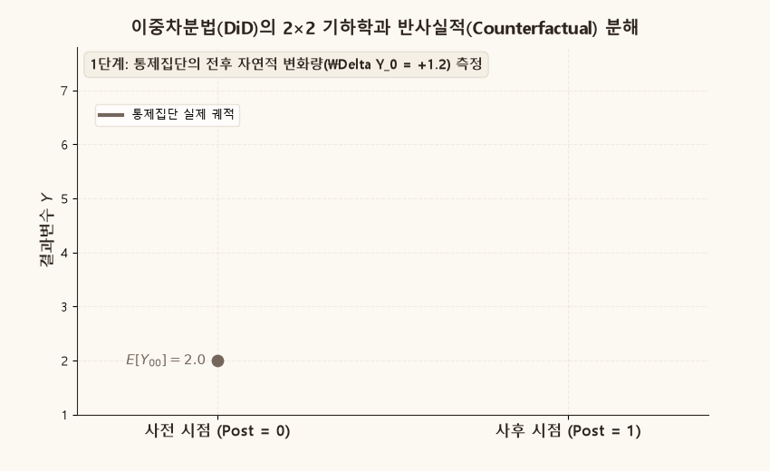
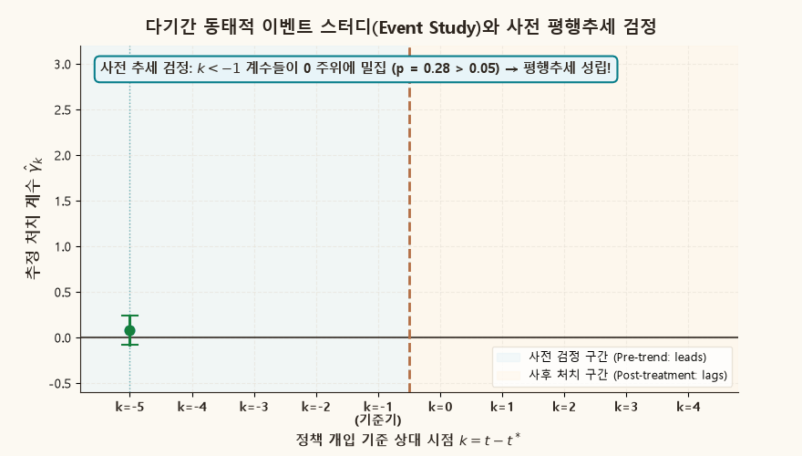
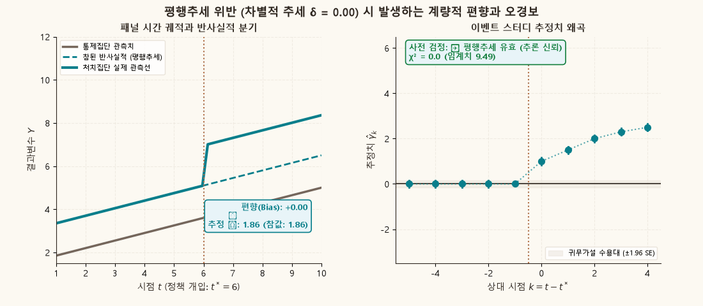
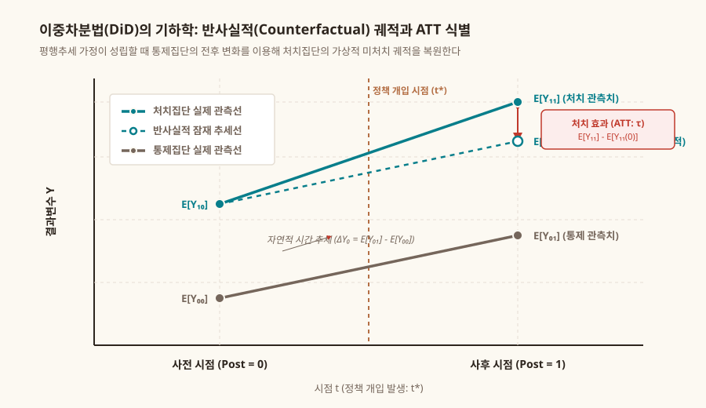

## 목적과 3대 핵심 계량경제학 명제

관측 데이터(Observational Data)를 이용해 정책이나 제도의 인과적 효과를 추정할 때 마주하는 가장 큰 장애물은 **선택 편향(Selection Bias)**이다. 처치를 받은 집단(Treatment Group)과 받지 않은 집단(Control Group)은 정책 도입 이전부터 이미 고유한 특성(능력, 제도, 선호 등)의 차이로 인해 서로 다른 출발선에 서 있기 때문이다.

**이중차분법(Difference-in-Differences, DiD)**은 이러한 선택 편향이 **시간에 걸쳐 일정하게 유지된다(Time-invariant Selection Bias)**는 전제하에, 통제집단의 전후 변화를 이용해 처치집단의 가상적 반사실적(Counterfactual) 궤적을 복원하고 순수한 **처치집단에 대한 평균 처치효과(ATT: Average Treatment Effect on the Treated)**를 식별하는 현대 실증경제학의 대표적 방법론이다.

::: {.callout-note appearance="simple"}
### 이중차분법과 평행추세의 3대 핵심 명제

1. **반사실적 상태(Counterfactual)와 2×2 이중차분 식별**:
   - 단순한 전후 비교($\Delta \bar{Y}_1$)는 거시적 시간 추세가 혼입되고, 단순한 집단 간 횡단면 비교($\bar{Y}_{11} - \bar{Y}_{01}$)는 고유한 수준 차이(선택 편향)가 혼입된다.
   - 통제집단의 시간적 변화량($\Delta \bar{Y}_0$)을 처치집단의 사전 상태($\bar{Y}_{10}$)에 가산함으로써, 처치가 없었을 경우의 **반사실적 기대치 $E[Y_{i1}(0)|D_i=1]$**를 식별한다:
     $$
     \tau_{\text{ATT}} = \big(E[Y_{i1}|D_i=1] - E[Y_{i0}|D_i=1]\big) - \big(E[Y_{i1}|D_i=0] - E[Y_{i0}|D_i=0]\big).
     $$

2. **식별의 보루: 평행추세 가정(Parallel Trends Assumption)**:
   - DiD 추정량이 인과적 효과를 일치 추정하기 위한 필요충분조건은 **"정책 개입이 없었더라면 두 집단이 동일한 시간 추세로 변화했을 것"**이라는 평행추세 가정이다.
   - 반사실적 상태는 현실에서 관측 불가능하므로 사후적으로 이 가정을 직접 입증할 수는 없다. 따라서 정책 도입 이전 기간의 궤적이 평행하게 움직였는지를 간접적으로 검증(Pre-trend Test)해야 한다.

3. **다기간 동태적 이벤트 스터디(Event Study)와 사전 검정의 한계**:
   - 다기간 패널에서 상대 시점 더미($k = t - t^*$)를 포함한 이벤트 스터디 모형을 통해 사전 추세($k < -1$)의 0선 수렴 여부와 사후($k \ge 0$) 동태적 파급 경로를 동시에 추적한다.
   - 단, 사전 검정(Pre-test)을 통과했다고 해서 평행추세가 사후에도 반드시 유지된다는 보장은 없으며(Roth, 2022), 미세한 차별적 추세(Differential Trend)만으로도 DiD 추정치에는 심각한 누적 편향이 침투할 수 있다.
:::

관련 교재 본문은 [Chapter 03 · Target, Model, and Identification](../econometrics/ch03-target-model-identification/contents.qmd), [Chapter 07 · Sample Least Squares](../econometrics/ch07-sample-least-squares/contents.qmd), 그리고 [Chapter 10 · Large-Sample Theory of Least Squares](../econometrics/ch10-large-sample-least-squares/contents.qmd)에서 다룬다.

---

## 1. 2×2 이중차분법의 기본 수리 구조와 분해

두 집단 $D_i \in \{0, 1\}$과 두 시점 $t \in \{0, 1\}$을 갖는 표준적인 2×2 패널 환경을 고려하자.

$$
Y_{it} = \beta_0 + \beta_1 D_i + \beta_2 \text{Post}_t + \tau (D_i \times \text{Post}_t) + \epsilon_{it}
$$

여기서 각 계수의 경제학적 의미는 다음과 같다:
- $\beta_0 = E[Y_{i0} \mid D_i=0]$: 통제집단의 사전 기준 수준
- $\beta_1 = E[Y_{i0} \mid D_i=1] - E[Y_{i0} \mid D_i=0]$: 사전 시점에서 두 집단 간의 고유한 수준 차이 (영구적 선택 편향)
- $\beta_2 = E[Y_{i1} \mid D_i=0] - E[Y_{i0} \mid D_i=0]$: 통제집단이 경험한 자연적 시간 추세
- $\tau$: 정책 처치에 따른 순수 증분 효과 (ATT)

각 셀(Cell)의 조건부 기댓값 행렬은 다음과 같이 정리된다:

| 집단 구분 | 사전 시점 ($\text{Post}=0$) | 사후 시점 ($\text{Post}=1$) | 1차 차분 (시간 차분: $\Delta_t$) |
| :--- | :---: | :---: | :---: |
| **처치집단 ($D=1$)** | $\beta_0 + \beta_1$ | $\beta_0 + \beta_1 + \beta_2 + \tau$ | $\beta_2 + \tau$ |
| **통제집단 ($D=0$)** | $\beta_0$ | $\beta_0 + \beta_2$ | $\beta_2$ |
| **집단 간 차분 ($\Delta_D$)** | $\beta_1$ (선택 편향) | $\beta_1 + \tau$ | **$\tau$ (이중차분 추정치)** |

잠재적 결과(Potential Outcomes) 표기법 $Y_{it}(1), Y_{it}(0)$으로 분해하면 다음과 같다:

$$
\Delta \bar{Y}_1 - \Delta \bar{Y}_0 = \underbrace{E[Y_{i1}(1) - Y_{i1}(0) \mid D_i=1]}_{\text{True ATT: } \tau} + \underbrace{\Big(E[Y_{i1}(0) - Y_{i0}(0) \mid D_i=1] - E[Y_{i1}(0) - Y_{i0}(0) \mid D_i=0]\Big)}_{\text{평행추세 위반에 따른 불일치 편향 (Non-parallel Bias)}}
$$

평행추세 가정이 성립할 때에만 두 번째 괄호 안의 항이 정확히 0이 되어 OLS 추정량 $\hat{\tau}$가 $\tau$의 불편·일치추정량이 된다.

아래 애니메이션은 통제집단의 시간 기울기가 처치집단의 기준점으로 평행하게 복제되어 **반사실적(Counterfactual) 상태 $E[Y_{11}(0)]$**를 구성하고, 실제 관측치와의 수직 격차로 ATT가 식별되는 기하학적 메커니즘을 보여준다.

{.supplement-graphic fig-alt="이중차분법 2x2 분해와 반사실적 점선 복제 및 ATT 식별 애니메이션"}

---

## 2. 다기간 패널과 이원 고정효과(TWFE) 이벤트 스터디

실제 정책 분석에서는 2개 시점뿐만 아니라 정책 도입 이전과 이후 수년에 걸친 패널 데이터를 사용한다. 다기간 패널에서는 개체 고정효과($\alpha_i$)와 시간 고정효과($\lambda_t$)를 모두 통제하는 **이원 고정효과(Two-Way Fixed Effects, TWFE) 회귀모형**을 구축한다.

$$
Y_{it} = \alpha_i + \lambda_t + \sum_{k \neq -1} \gamma_k \cdot \big(\mathbf{1}(t - t^* = k) \times D_i\big) + \epsilon_{it}
$$

여기서 $t^*$는 정책 개입 시점이며, $k = t - t^*$는 정책 도입을 기준으로 한 상대적 사건 시점(Event Time)이다.

### 1) 기준기 $k = -1$ 정규화
완전 다중공선성(Dummy Variable Trap)을 회피하고 모든 효과를 정책 직전기와 비교하기 위해, **$k = -1$ 시점의 더미는 모형에서 의도적으로 누락(Omitted)시키고 $\gamma_{-1} = 0$으로 정규화**한다. 따라서 각 $\hat{\gamma}_k$는 "정책 직전기 대비 $k$ 시점에 처치집단과 통제집단 간 격차가 어떻게 변화했는가"를 측정한다.

### 2) 사전 평행추세 검정 (Pre-trend Joint Test)
정책 도입 이전인 $k < -1$ 기간에 대해 다음 결합 귀무가설을 $\chi^2$ 또는 $F$-검정으로 평가한다:

$$
H_0: \gamma_{-K_{\text{pre}}} = \dots = \gamma_{-3} = \gamma_{-2} = 0
$$

- 만약 귀무가설을 기각하지 못한다면($p > 0.05$), 정책 이전 두 집단의 궤적이 통계적으로 유의미한 차이 없이 평행하게 유지되었다는 유력한 증거가 된다.
- 만약 귀무가설이 강력히 기각된다면($p < 0.05$), 이미 정책 도입 전부터 두 집단의 추세가 갈라지고 있었음을 의미하므로 단순 DiD 추정치는 신뢰할 수 없다.

### 3) 오차항의 자기상관과 군집 표준오차(Clustered Standard Errors)
Bertrand, Duflo, and Mullainathan (2004)이 지적하였듯, 패널 데이터의 오차항 $\epsilon_{it}$는 동일 개체 내에서 높은 양(+)의 자기상관을 갖는다. 통상적인 OLS 표준오차를 사용할 경우 표준오차가 최대 50~80% 과소추정되어 가짜 유의성(Spurious Significance)을 낳는다. 따라서 반드시 **개체 수준 군집 강건 공분산 행렬(Cluster-Robust Covariance Matrix)**을 사용해야 한다:

$$
\widehat{\text{Var}}(\hat{\gamma}) = (Z'M Z)^{-1} \left( \sum_{i=1}^N Z_i' M_i \hat{e}_i \hat{e}_i' M_i Z_i \right) (Z'M Z)^{-1}
$$

아래 애니메이션은 상대 시점 $k = -5$부터 $+4$까지 순차적으로 이벤트 스터디 추정치와 95% 신뢰구간이 전개되는 동학을 보여준다.

{.supplement-graphic fig-alt="이벤트 스터디 추정점과 95% 신뢰구간이 사전에는 0선에 머물고 사후에 양의 효과로 누적 발현되는 애니메이션"}

---

## 3. 평행추세 위반과 추정치 편향 (Differential Trend)

만약 처치집단에만 관측되지 않는 선형 차별적 추세 $\delta \cdot t \cdot D_i$가 존재한다면 어떤 일이 벌어지는가?

이원 고정효과 추정량 하에서 차별적 추세는 이벤트 스터디 계수에 선형적인 경사 $\delta \times (k - (-1))$를 유발한다:

$$
E[\hat{\gamma}_k] = \gamma_k^{\text{True}} + \delta \cdot (k + 1)
$$

이로 인해 두 가지 치명적인 계량적 재앙이 발생한다:
1. **사전 추세의 왜곡**: $k < -1$ 시점에서 $E[\hat{\gamma}_k] = \delta(k + 1) \neq 0$이 되어 사전 계수들이 0선 아래(또는 위)로 뚜렷하게 기울어진다.
2. **처치효과의 심각한 과대/과소추정**: 단순 2×2 DiD 추정치는 순수 처치효과 $\tau$에 시간 누적분 $\delta \cdot \Delta t$가 더해진 편향점 $\tau + \delta \Delta t$로 수렴한다.

아래 애니메이션은 차별적 추세 $\delta$가 0에서 0.60까지 커짐에 따라, 패널 궤적이 갈라지고 이벤트 스터디 사전 검정에서 붉은 경고등($p < 0.001$)이 켜지며 추정치가 편향되는 전 과정을 대조한다.

{.supplement-graphic fig-alt="평행추세 위반 크기에 따른 패널 궤적의 분기와 이벤트 스터디 사전추세 왜곡 및 추정치 편향 애니메이션"}

---

## 4. 브라우저 인터랙티브 탐색기

아래 대화형 도구에서 참된 처치효과 $\tau$와 차별적 추세 기울기 $\delta$, 표본 오차 크기를 직접 변경하며, 반사실적 분기와 이벤트 스터디 $\chi^2$ 통계량이 어떻게 실시간으로 변하는지 관찰할 수 있다.

```{=html}
<iframe src="interactive/did-parallel-trends/index.html" width="100%" height="640" frameborder="0" style="border: 1px solid #e5ded3; border-radius: 8px; background: #fcf9f2;"></iframe>
```

::: {.callout-tip appearance="simple"}
### 조작 가이드 및 관찰 포인트
1. **평행추세 충족 ($\delta = 0.00$)**:
   - 상단 그래프에서 통제집단과 처치집단 반사실적 점선이 완벽하게 평행을 이룬다.
   - 하단 이벤트 스터디에서 $k < -1$ 계수들이 모두 0선 신뢰구간 안에 안착하며 $p > 0.05$로 평행추세가 지지된다.
2. **미세한 위반 ($\delta = 0.15$)**:
   - 단순 DiD 추정치는 참값보다 약 $+0.75$ 가량 과대평가된다.
   - 이벤트 스터디의 사전 계수들이 음(-)의 방향으로 완만하게 하강하며 경계선에 걸치기 시작한다.
3. **심각한 위반 ($\delta = 0.40$)**:
   - 사전 검정 p-값이 즉시 $0.001$ 미만으로 추락하며 "❌ 평행추세 기각" 경고가 발생한다. 이 경우 통상적인 DiD 분석 결과를 학술적으로 신뢰할 수 없다.
:::

자바스크립트가 지원되지 않는 환경을 위한 고해상도 벡터 도해는 다음과 같다:

{.supplement-graphic fig-alt="이중차분법 2x2 기하와 반사실적 궤적 및 ATT를 보여주는 정적 벡터 SVG"}

---

## 5. Monte Carlo 시뮬레이션 수치 벤치마크

개체 수 $N = 1,000$ (처치 500, 통제 500), 총 관측기간 $T = 10$ ($t^* = 6$, 사전 5기, 사후 5기), 오차 AR(1) 상관계수 $\rho = 0.40$, 참된 평균 ATT $\tau = 1.86$ 환경에서 1,000회 Monte Carlo 반복 실험을 수행한 결과는 다음과 같다.

| 시나리오 구분 | 차별적 추세 ($\delta$) | 단순 DiD 평균 $\hat{\tau}$ | 참값 대비 편향 (Bias) | 추정량 RMSE | 사전검정 기각률 ($\alpha=0.05$) | 계량경제학적 판단 |
| :--- | :---: | :---: | :---: | :---: | :---: | :--- |
| **A. 평행추세 성립** | $0.00$ | $1.8599$ | **$-0.0001$** | $0.0529$ | **$4.4\%$** | 불편성 성립, 명목 유의수준(5%) 정확히 보존 |
| **B. 미세한 위반** | $0.25$ | $3.1099$ | **$+1.2499$** | $1.2510$ | **$100.0\%$** | 편향 $+67\%$ 폭증, 사전검정에서 100% 탐지 |
| **C. 심각한 위반** | $0.60$ | $4.8599$ | **$+2.9999$** | $3.0004$ | **$100.0\%$** | 편향 $+161\%$ 폭증, 식별 완전 붕괴 |

### 수치 분석의 주요 함의:
1. **평행추세 성립 시의 우수성**:
   - $\delta = 0.00$일 때 단순 DiD 추정량의 평균은 $1.8599$로 참값 $1.8600$과 오차 $0.0001$ 이내에서 일치하며, 4개 사전 시점에 대한 결합 $\chi^2$ 검정의 기각률은 $4.4\%$로 공칭 5% 수준을 완벽하게 충족한다.
2. **차별적 추세의 누적 파괴력**:
   - 차별적 추세 $\delta = 0.25$가 추가될 때, 5기간 동안 누적된 효과($5 \times 0.25 = 1.25$)가 DiD 추정치에 그대로 전가되어 참값 대비 무려 $67\%$의 과대추정 편향을 초래한다.
3. **이벤트 스터디의 위반 탐지력**:
   - 표본 크기 $N=1,000$ 수준에서는 $\delta \ge 0.25$인 차별적 추세가 존재할 경우 사전 검정의 기각률이 $100\%$에 달하여 연구자에게 강력한 경고 신호를 보낸다.

---

## 6. 재현 코드 및 스크립트 실행 안내

본 보충자료의 모든 수치 계산과 애니메이션은 순수 Julia 및 Python 스크립트로 100% 재현할 수 있다.

### Julia 계산 엔진 실행
외부 라이브러리 없이 Julia 표준 라이브러리(`LinearAlgebra`, `Statistics`, `Random`)만으로 구동되는 단독 실행형 스크립트이다:

```bash
# DiD 패널 DGP 생성, TWFE 추정, 1,000회 Monte Carlo 및 데이터 저장
julia supplements/julia/did_parallel_trends.jl
```

산출 파일:
- `assets/data/did-event-study-baseline.csv`: 시점별 추정계수 및 95% 신뢰구간
- `assets/data/did-parallel-trends-metadata.json`: DGP 파라미터 및 몬테카를로 통계량
- `assets/images/did-parallel-trends-static.svg`: 고해상도 정적 벡터 다이어그램

### Python 애니메이션 GIF 빌더 실행
Matplotlib과 Pillow를 이용해 사이트 전용 테마로 3종의 출판급 GIF를 렌더링한다:

```bash
# 3종 고해상도 GIF 일괄 생성
python scripts/generate_did_gifs.py
```

스크립트 구조:
- `generate_gif_did_mechanism()`: 2×2 기하학과 반사실적 분해 애니메이션
- `generate_gif_event_study()`: 다기간 이벤트 스터디 사전추세 검정 및 동태적 누적 효과
- `generate_gif_violation_bias()`: 차별적 추세 $\delta$ 증가에 따른 패널 분기와 이벤트 스터디 왜곡 2-패널 대조

---

## 7. 본문 교재 연계 및 실무 연구자를 위한 체크리스트

### 본문 챕터 연계
- [Chapter 03 · Target, Model, and Identification](../econometrics/ch03-target-model-identification/contents.qmd): 조건부 기댓값 함수와 인과적 모수(ATT)의 비모수적 식별.
- [Chapter 07 · Sample Least Squares](../econometrics/ch07-sample-least-squares/contents.qmd): OLS 대수적 성질과 더미변수 회귀, Frisch–Waugh–Lovell(FWL) 정리.
- [Chapter 10 · Large-Sample Theory of Least Squares](../econometrics/ch10-large-sample-least-squares/contents.qmd): 패널 이원고정효과(TWFE)와 군집 강건 공분산 행렬 추정.

### 실무 연구자를 위한 5단계 DiD 분석 프로토콜
1. **원천 데이터의 시계열 도식화**: 회귀분석을 돌리기 전, 처치집단과 통제집단의 원천 평균 궤적을 반드시 시각화하여 사전 추세의 평행 여부를 육안으로 점검한다.
2. **이벤트 스터디 계수 보고**: 단순 2×2 DiD 단일 계수만 보고하지 말고, 사전 $k < -1$ 계수들과 95% 신뢰구간 에러바를 플롯하여 학계에 투명하게 공개한다.
3. **군집 표준오차 적용**: 동일 개체 내 자기상관으로 인한 1종 오류(Type I Error) 팽창을 방지하기 위해 최소한 주(State)나 개체(Entity) 수준의 Clustered SE를 사용한다.
4. **이질적 처치 효과 주의 (Callaway–Sant'Anna / Sun–Abraham)**: 정책 도입 시점이 개체마다 서로 다른 시차 처치(Staggered Adoption) 환경에서는 고전적 TWFE가 음(-)의 가중치 문제를 유발할 수 있으므로 현대적 이질성 강건 추정량을 병행 검토한다.
5. **사전 검정 맹신 금지 (Honest DiD)**: 사전 검정에서 $p > 0.05$가 나왔더라도 통계적 검정력 부족(Power Deficiency)일 수 있으므로, Rambachan and Roth (2023)의 민감도 분석(Sensitivity Analysis)을 통해 허용 가능한 선형 이탈 한계를 점검한다.
